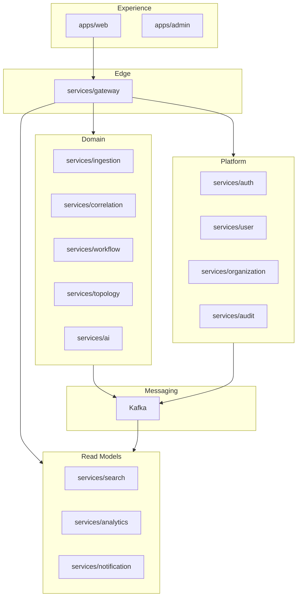
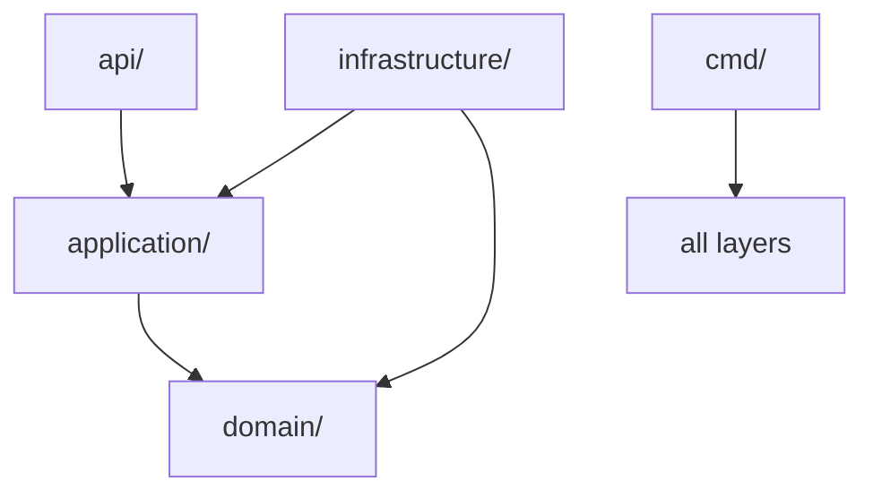

# Halcyon Architecture

## Why This Document Exists

This is the authoritative reference for how Halcyon is structured — service
boundaries, dependency rules, and layering conventions. It prevents architectural
drift as the contributor count grows.

Changes to this document require an ADR.

## Who Reads This

| Audience | Purpose |
|---|---|
| All backend engineers | Package and layer rules |
| Reviewers | Enforce boundaries in PR review |
| New hires | Onboarding to system structure |
| Architects | Evaluate proposed changes |

## Standards for Every PR

- Must not violate dependency rules defined below.
- New services must follow the standard internal layout.
- Cross-service communication only via API or Kafka — never shared database access.
- If this document changes, update it in the **same PR** as the implementation change.

---

## System Context

Halcyon is a multi-tenant, event-driven SaaS platform deployed on AWS (EKS).



---

## Repository Layout (Frozen)

```
halcyon/
├── apps/              # Frontend applications
├── contracts/         # OpenAPI + event schemas
├── deploy/            # Helm, environment values
├── docs/              # ADRs, RFCs, guides
├── infra/             # Terraform, Docker, observability config
├── pkg/platform/      # Shared Go platform libraries
├── services/          # Microservices (bounded contexts)
├── tests/             # Cross-service tests
└── tools/             # Codegen, CLIs
```

---

## Service Internal Layout

Every Go microservice follows Clean Architecture:

```
services/<name>/
├── cmd/<name>/main.go           # Composition root (DI wiring only)
├── migrations/                  # SQL migrations (golang-migrate)
├── internal/
│   ├── domain/                  # Aggregates, VOs, events, repo interfaces
│   ├── application/             # Use cases, commands, queries, ports
│   ├── infrastructure/          # Adapters
│   │   ├── postgres/
│   │   ├── redis/
│   │   └── kafka/
│   ├── api/
│   │   └── http/                # Handlers, DTOs, routing
│   └── config/                  # Service configuration
├── go.mod
└── README.md
```

---

## Layer Dependency Rules



| Layer | May Import | Must NOT Import |
|---|---|---|
| `domain` | Standard library only | application, infrastructure, api, other services |
| `application` | domain | infrastructure, api |
| `infrastructure` | domain, application (ports only) | api |
| `api` | application, domain (DTO mapping only) | infrastructure |
| `cmd` | all layers (wiring only) | — |

**Business logic lives in `domain` and `application` only.**

---

## Cross-Service Rules

| Rule | Detail |
|---|---|
| No service imports another service | Communicate via HTTP/gRPC or Kafka |
| No shared databases | Each service owns its schema |
| `pkg/platform` never imports `services/` | Platform code is generic |
| `contracts/` is schema-only | Validated in CI; codegen at boundaries |
| `apps/` never imports Go service code | HTTP/GraphQL only |

---

## Bounded Contexts

| Context | Service | Aggregate Roots |
|---|---|---|
| Identity | `auth` | User (auth), Session, ApiKey |
| Profiles | `user` | UserProfile |
| Tenancy | `organization` | Organization, Team, Membership |
| Edge | `gateway` | — (stateless) |
| Ingestion | `ingestion` | Signal, WebhookConfig |
| Correlation | `correlation` | CorrelationRule, Match |
| Incidents | `workflow` | Incident, Timeline, Postmortem |
| Topology | `topology` | Service, Dependency |
| Intelligence | `ai` | Analysis, PromptTemplate |
| Search | `search` | — (read model) |
| Analytics | `analytics` | — (read model) |
| Notifications | `notification` | Notification, Delivery |
| Compliance | `audit` | AuditEntry |

---

## Communication Patterns

| Pattern | When | Example |
|---|---|---|
| REST `/api/v1/` | Commands, CRUD, webhooks | `POST /incidents` |
| GraphQL | Complex read aggregation | Incident command center |
| gRPC | Internal low-latency calls | RBAC check, auth introspection |
| WebSocket | Real-time push | Live timeline |
| Kafka events | State propagation, fan-out | `incidents.incident.created` |

### CQRS

Write path: `workflow` (PostgreSQL).  
Read path: `search` (Elasticsearch), `analytics` (PostgreSQL rollups).

Justified because read and write patterns, scaling profiles, and stores differ.

---

## Multi-Tenancy

Every layer enforces `org_id` isolation:

| Layer | Mechanism |
|---|---|
| API | JWT `org_id` claim |
| Application | Authorization checks |
| Database | `org_id` column + Row-Level Security |
| Kafka | Partition key = `org_id` |
| Search | Shared index + mandatory `org_id` filter |
| Logs/Traces | `org_id` attribute (not metric label) |

---

## Shared Platform Libraries

`pkg/platform/` contains cross-cutting code used by 2+ services:

| Package | Purpose |
|---|---|
| `observability` | Logging, metrics, tracing bootstrap |
| `httperrors` | RFC 7807 Problem Details |
| `httputil` | JSON rendering helpers |
| `events` | Event envelope, validation |
| `ids` | Prefixed ID types |

**Rule:** No business logic in `pkg/platform/`.

---

## Go Workspace

Root `go.work` links all Go modules. Each service has its own `go.mod`.

---

## Related Documents

| Document | Scope |
|---|---|
| [SYSTEM_DESIGN.md](SYSTEM_DESIGN.md) | Product and platform design |
| [API_GUIDELINES.md](API_GUIDELINES.md) | REST/GraphQL conventions |
| [EVENT_GUIDELINES.md](EVENT_GUIDELINES.md) | Kafka and event schemas |
| [DATABASE_GUIDELINES.md](DATABASE_GUIDELINES.md) | Storage per service |
| [docs/adr/](docs/adr/) | Architecture decisions |
