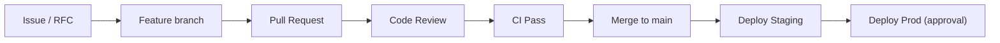

# Contributing to Halcyon

## Why This Document Exists

Halcyon is engineered for contribution at scale — from solo maintainers to 100+
contributors. This document defines how work enters the repository, how it is
reviewed, and what quality bar every change must meet.

## Who Reads This

| Audience | Purpose |
|---|---|
| External contributors | First PR checklist |
| Core team | Review and merge standards |
| Hiring managers | Engineering maturity signal |

## Standards for Every PR

Every pull request must comply with this document. Reviewers may reject PRs that
violate these standards regardless of technical merit.

---

## Before You Start

1. Read [README.md](README.md) and [ARCHITECTURE.md](ARCHITECTURE.md)
2. Set up local development: [docs/onboarding/local-development.md](docs/onboarding/local-development.md)
3. For non-trivial changes, open an [RFC](docs/rfc/README.md) or [ADR](docs/adr/README.md) first
4. Check [ROADMAP.md](ROADMAP.md) for alignment

---

## Contribution Workflow



### 1. Branch Naming

```
feat/auth-oauth-login
fix/workflow-invalid-transition
docs/api-guidelines-update
chore/ci-add-lint
refactor/search-index-mapping
```

### 2. Commit Messages

Use [Conventional Commits](https://www.conventionalcommits.org/):

```
<type>(<scope>): <description>

[optional body]

[optional footer]
```

| Type | Use |
|---|---|
| `feat` | New feature |
| `fix` | Bug fix |
| `refactor` | Code change without behavior change |
| `docs` | Documentation only |
| `test` | Tests only |
| `chore` | Build, CI, tooling |
| `perf` | Performance improvement |

**Scopes:** service name (`auth`, `workflow`) or area (`infra`, `contracts`, `docs`).

### 3. Pull Request Size

| Guideline | Target |
|---|---|
| Lines changed | < 400 |
| Files changed | < 15 |
| Scope | One capability per PR |

If a PR exceeds these limits, split it or open an RFC explaining why.

### 4. Pull Request Description

Every PR must include:

- **Business motivation** — why this change matters
- **Engineering motivation** — what technical problem it solves
- **Design decisions** — what was chosen and why
- **Tradeoffs** — what was sacrificed
- **Alternatives rejected** — what was considered and not chosen
- **Testing** — what was tested and how to verify
- **Documentation** — what docs were updated
- **ADR/RFC link** — if applicable

Use `.github/PULL_REQUEST_TEMPLATE.md` when opening PRs on GitHub.

---

## Code Requirements

| Requirement | Reference |
|---|---|
| Clean Architecture layer rules | [ARCHITECTURE.md](ARCHITECTURE.md) |
| Coding style | [CODE_STYLE.md](CODE_STYLE.md) |
| Tests | [TESTING.md](TESTING.md) |
| API design | [API_GUIDELINES.md](API_GUIDELINES.md) |
| Events | [EVENT_GUIDELINES.md](EVENT_GUIDELINES.md) |
| Database | [DATABASE_GUIDELINES.md](DATABASE_GUIDELINES.md) |
| Observability | [OBSERVABILITY.md](OBSERVABILITY.md) |
| Security | [SECURITY.md](SECURITY.md) |
| Performance | [PERFORMANCE_GUIDELINES.md](PERFORMANCE_GUIDELINES.md) |

---

## Review Process

### Reviewer Checklist

- [ ] Architecture boundaries respected
- [ ] Tests adequate and passing
- [ ] Documentation updated
- [ ] No secrets or PII in code/logs
- [ ] Observability (logs, metrics) present
- [ ] Error handling explicit
- [ ] Multi-tenant isolation considered
- [ ] ADR created for non-trivial decisions

### CODEOWNERS

Changes to certain paths require approval from designated owners.
See `.github/CODEOWNERS`.

### Merge Policy

- `main` is always deployable
- Squash merge for feature branches (default)
- At least one approval required
- CI must pass
- **All Quality Gate items must pass** — see below
- Production deploys require manual approval — see [RELEASE_PROCESS.md](RELEASE_PROCESS.md)

---

## Quality Gate

**A PR cannot be merged unless every item passes.**

### Build

- [ ] Workspace builds successfully

### Formatting

- [ ] `gofmt` (no diff)
- [ ] `go vet`
- [ ] `golangci-lint` (required in CI — run `make ci` locally)

### Tests

- [ ] All unit tests pass (`make test`)
- [ ] Race detector passes (`make test-race`)
- [ ] Coverage reported (`make coverage`)
- [ ] Integration tests pass when infrastructure changes (`make test-integration`)
- [ ] OpenAPI contracts validated (`make validate-openapi`)
- [ ] Migrations validated (`make validate-migrations`)

### Security

- [ ] No secrets committed
- [ ] No hardcoded credentials
- [ ] Configuration via environment variables
- [ ] `govulncheck` passes (`make security-vuln`)

### Architecture

- [ ] Clean Architecture dependency rules respected
- [ ] No cyclic dependencies
- [ ] No business logic in HTTP layer
- [ ] Service architecture doc updated (`docs/services/<name>.md`) when adding or changing a service

### Observability

- [ ] Structured logs
- [ ] Metrics exposed
- [ ] Health endpoint
- [ ] Readiness endpoint

### Documentation

- [ ] README updated if needed
- [ ] OpenAPI updated for API changes
- [ ] ADR/RFC updated if architecture changed
- [ ] Performance budgets defined for new public endpoints

### Repository

- [ ] No generated file exceeds engineering standards (~200 lines per file when practical)
- [ ] No duplicated logic
- [ ] No TODO comments

---

## RFC and ADR Process

| Change Type | Process |
|---|---|
| Small bug fix | PR only |
| New feature in existing service | PR + update docs |
| New service | RFC → ADR → PR |
| Breaking API/event change | RFC → ADR → version bump |
| Architecture change | RFC → ADR → team review |

- **RFC:** Proposal before implementation — [docs/rfc/](docs/rfc/)
- **ADR:** Record of decision — [docs/adr/](docs/adr/)

---

## Development Setup

```bash
make dev      # Start local infrastructure
make test     # Run tests
make test-race # Run race detector
make ci       # Run full CI checks locally
make lint     # Run linters
make security-vuln # Dependency vulnerability scan
```

See [docs/onboarding/ci.md](docs/onboarding/ci.md) for CI details and [docs/onboarding/branch-protection.md](docs/onboarding/branch-protection.md) for merge requirements.

---

## Community

- [Code of Conduct](CODE_OF_CONDUCT.md)
- [Security Policy](SECURITY.md)

Be respectful. Assume good intent. Disagree on technical merit.
