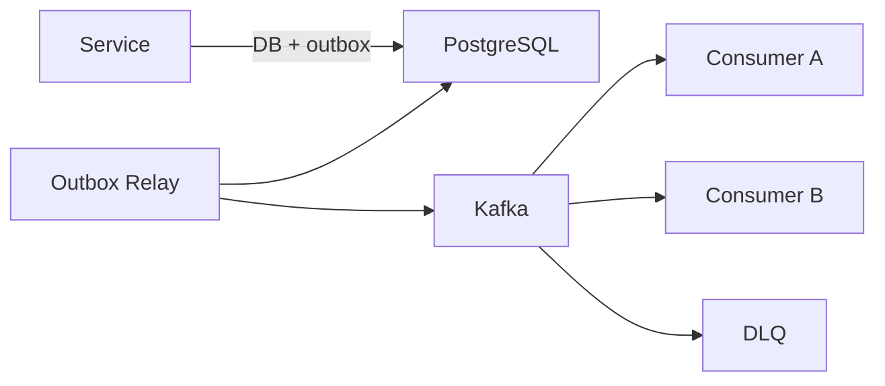

# Event Guidelines

## Why This Document Exists

Halcyon is event-driven at its core. Inconsistent event schemas cause consumer
bugs, replay failures, and data corruption at scale. This document defines how
events are designed, versioned, produced, and consumed.

## Who Reads This

| Audience | Purpose |
|---|---|
| Service engineers | Publish and consume events correctly |
| Reviewers | Validate event schema changes |
| Operators | Understand replay and DLQ procedures |

## Standards for Every PR

- New events must be defined in `contracts/events/` before implementation.
- Event schemas validated in CI on every PR touching `contracts/events/`.
- Consumers must be idempotent (`event_id` deduplication).
- Producers must use transactional outbox pattern (no dual writes).
- Breaking event changes require new version and ADR.

---

## Event-Driven Architecture



---

## Event Envelope (Required)

Every event uses this envelope. Defined in `contracts/events/envelope/v1/schema.json`.

```json
{
  "event_id": "evt_unique_id",
  "event_type": "incidents.incident.created",
  "event_version": "1.0",
  "timestamp": "2026-07-30T22:15:00.123Z",
  "source": "workflow",
  "correlation_id": "corr_abc",
  "causation_id": "evt_previous",
  "org_id": "org_xyz",
  "actor": {
    "type": "user",
    "id": "usr_abc"
  },
  "metadata": {
    "trace_id": "abc123",
    "idempotency_key": "idem_xyz"
  },
  "payload": { }
}
```

---

## Naming Convention

```
<domain>.<aggregate>.<verb>

Examples:
  auth.user.registered
  incidents.incident.created
  incidents.incident.resolved
  signals.alert.received
  correlations.match.found
  ai.analysis.completed
```

- Past tense verbs for facts
- `.requested` suffix for commands: `incidents.incident.analyze.requested`

---

## Kafka Topics

| Topic | Domain |
|---|---|
| `halcyon.auth` | Authentication events |
| `halcyon.organizations` | Tenancy and RBAC |
| `halcyon.changes` | Deploy and config change signals |
| `halcyon.signals` | Alert and telemetry signals |
| `halcyon.correlations` | Correlation matches |
| `halcyon.incidents` | Incident lifecycle |
| `halcyon.ai` | AI analysis results |
| `halcyon.notifications` | Delivery status |
| `halcyon.documents` | Document indexing |
| `halcyon.*.dlq` | Dead letter queues |

### Partitioning

- **Partition key:** `org_id`
- Guarantees per-tenant ordering
- Monitor for hot partitions at scale

### Retention

- Hot: 7 days in Kafka
- Warm: 90 days in S3 (event archive)
- Cold: compliance-driven (audit)

---

## Producing Events

### Transactional Outbox

```
BEGIN TRANSACTION
  UPDATE incident SET status = 'resolved'
  INSERT INTO outbox (event_type, payload, org_id)
COMMIT

-- Separate relay process publishes from outbox to Kafka
```

**Never** publish to Kafka and write to DB in separate non-transactional steps.

### Producer Configuration

- `acks=all`
- `enable.idempotence=true`
- Compression: `lz4`

---

## Consuming Events

### Idempotency (Required)

```sql
INSERT INTO processed_events (event_id, event_type, org_id, processed_at)
VALUES ($1, $2, $3, NOW())
ON CONFLICT (event_id) DO NOTHING;
```

If row count = 0, skip processing (duplicate).

### Consumer Rules

1. Deserialize and validate against schema
2. Check idempotency
3. Process business logic
4. Commit Kafka offset **after** successful processing
5. On failure: retry with backoff → DLQ after max retries

### Retry Strategy

| Failure Type | Retries | Backoff |
|---|---|---|
| Transient (DB timeout) | 3 | 1s, 2s, 4s |
| Downstream unavailable | 5 | 5s–120s |
| Deserialization error | 0 | Immediate DLQ |
| Business logic rejection | 0 | Immediate DLQ |

---

## Delivery Semantics

| Layer | Guarantee |
|---|---|
| DB + outbox write | Exactly-once |
| Outbox → Kafka | At-least-once |
| Kafka → consumer | At-least-once |
| Effective processing | **Effectively once** (idempotent consumers) |

We do **not** use Kafka transactions for end-to-end exactly-once. Idempotent
consumers are simpler, cheaper, and sufficient.

---

## Schema Versioning

| Change | Allowed | Compatibility |
|---|---|---|
| Add optional field | Yes | Backward compatible |
| Remove optional field | Yes | Forward compatible |
| Rename field | No | Add new, deprecate old |
| Change field type | No | New `event_version` |
| Change semantic meaning | No | New `event_type` |

### Version Field

`event_version: "1.0"` in envelope. Breaking changes → `"2.0"`.

Future: Avro + Schema Registry (ADR when Kafka is production-ready).

---

## Dead Letter Queue

- One DLQ topic per source topic: `halcyon.incidents.dlq`
- Alert on any DLQ message (PagerDuty)
- Manual replay via `tools/dlq-replay` CLI
- DLQ retention: 30 days

---

## Event Catalog

Maintained in `docs/events/catalog.md`. Updated in the same PR as new events.

---

## Related Documents

- [ARCHITECTURE.md](ARCHITECTURE.md)
- [DATABASE_GUIDELINES.md](DATABASE_GUIDELINES.md)
- [TESTING.md](TESTING.md)
- `contracts/events/README.md`
