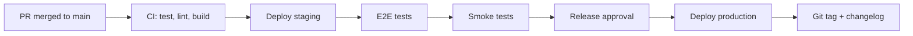

# Release Process

## Why This Document Exists

Predictable releases build customer trust and reduce on-call pain. This document
defines how Halcyon versions, tests, deploys, and communicates changes — from
merge to production.

## Who Reads This

| Audience | Purpose |
|---|---|
| Release managers | Execute release checklist |
| Service engineers | Understand deploy expectations |
| SRE / on-call | Know rollback procedures |
| Customers | Via changelog and release notes |

## Standards for Every PR

- User-facing changes require CHANGELOG entry in the same PR.
- Breaking API or event changes require version bump and migration guide.
- Database migrations must be backward-compatible with previous app version.
- Feature flags required for risky or incomplete features.
- No direct deploys to production outside this process.

---

## Versioning

Halcyon follows [Semantic Versioning 2.0.0](https://semver.org/).

| Bump | When |
|---|---|
| **MAJOR** | Breaking API, event schema, or auth changes |
| **MINOR** | New features, backward-compatible |
| **PATCH** | Bug fixes, security patches, performance |

Pre-1.0 (`0.x.y`): MINOR may include breaking changes with migration notes.

### Monorepo Tagging

- Platform releases: `v1.4.2` (tags entire monorepo)
- Individual service images: `auth:v1.4.2` (ECR tags)
- Contracts: versioned in `contracts/` independently when needed

---

## Branch Strategy

```
main ─────────────────────────────────────► production
  │
  ├── feature/<ticket>-<description>  (short-lived)
  ├── fix/<ticket>-<description>
  └── release/v1.4.x                  (patch branches)
```

| Branch | Deploys To | Protection |
|---|---|---|
| `main` | Staging (auto) → Production (manual promote) | Required reviews, CI green |
| `release/v*.*.x` | Production patches | Cherry-pick only |
| Feature branches | Preview environments (future) | CI only |

---

## Release Cadence

| Type | Cadence | Contents |
|---|---|---|
| **Regular** | Biweekly (Tuesday) | Features, improvements |
| **Patch** | As needed | Bug fixes, security |
| **Hotfix** | Emergency | Severity-1 production issues |

Security fixes may bypass regular cadence. See [SECURITY.md](SECURITY.md).

---

## Release Pipeline



### CI Gates (Required)

- Unit tests pass
- Integration tests pass
- Contract validation (OpenAPI, events)
- Lint and format check
- Security scan (Trivy, Dependabot)
- Docker image build succeeds

### Staging Validation

- Automated E2E suite (`tests/e2e/`)
- Manual smoke test checklist (release manager)
- Soak period: minimum 4 hours on staging before production promote

---

## Deployment Strategy

| Service Tier | Strategy | Rollback |
|---|---|---|
| Gateway, auth | Blue-green | Instant traffic switch |
| Domain services | Rolling (maxUnavailable: 0) | Helm rollback |
| Workers / consumers | Rolling | Helm rollback + Kafka offset management |
| Database migrations | Forward-only, pre-deploy | Forward fix migration |

### Helm

- Charts in `deploy/helm/<service>/`
- Values per environment: `deploy/values/staging.yaml`, `production.yaml`
- Deploy command: `helm upgrade --install` via GitHub Actions

### Feature Flags

- Incomplete features ship behind flags (LaunchDarkly or env-based)
- Flag defaults: `off` in production until explicitly enabled
- Remove flags within 2 releases of full rollout

---

## Database Migrations in Releases

1. Run migration **before** deploying new app version (expand phase)
2. Deploy new app version (reads/writes new schema)
3. Run cleanup migration in subsequent release (contract phase)

Never deploy app code that requires a schema change before the migration runs.

---

## Changelog and Communication

### CHANGELOG.md

Follow [Keep a Changelog](https://keepachangelog.com/) format:

```markdown
## [1.4.0] - 2026-08-15

### Added
- Incident auto-correlation for Datadog alerts (#142)

### Changed
- API rate limits increased for Enterprise tier (#138)

### Fixed
- Webhook signature validation for GitHub Enterprise (#145)

### Security
- JWT refresh token rotation hardening (#140)
```

### Release Notes

Published on GitHub Releases for every tag. Include:

- Summary of changes (customer-facing language)
- Migration guide for breaking changes
- Known issues
- Security acknowledgments (if applicable)

### Customer Communication

| Change Type | Channel |
|---|---|
| Breaking API | Email + in-app banner + docs |
| New feature | Changelog + blog post |
| Security fix | Coordinated disclosure timeline |
| Incident | Status page |

---

## Rollback Procedure

### Application Rollback

```bash
helm rollback <release> <revision> -n halcyon-production
```

### Criteria for Rollback

- Error rate > 5% for 3 minutes post-deploy
- p99 latency > 2x baseline for 5 minutes
- Critical functionality broken (auth, incident creation)
- Data integrity issue detected

### Database Rollback

- **Do not run down migrations in production**
- Ship forward fix migration or restore from PITR (last resort)
- Document in incident postmortem

---

## Hotfix Process

1. Branch from production tag: `hotfix/v1.4.1`
2. Minimal fix only — no feature work
3. Expedited review (1 approver + security if applicable)
4. Deploy directly to production after CI green
5. Cherry-pick to `main`
6. Tag `v1.4.1`

---

## Release Checklist

- [ ] CHANGELOG updated
- [ ] All CI gates green on `main`
- [ ] Staging E2E passed
- [ ] Database migrations reviewed and applied to staging
- [ ] Feature flags configured
- [ ] Rollback plan documented
- [ ] On-call notified of deploy window
- [ ] Deploy to production
- [ ] Post-deploy smoke test
- [ ] Git tag created
- [ ] GitHub Release published
- [ ] Monitor dashboards for 30 minutes

---

## Related Documents

- [SECURITY.md](SECURITY.md)
- [TESTING.md](TESTING.md)
- [ARCHITECTURE.md](ARCHITECTURE.md)
- [CONTRIBUTING.md](CONTRIBUTING.md)
