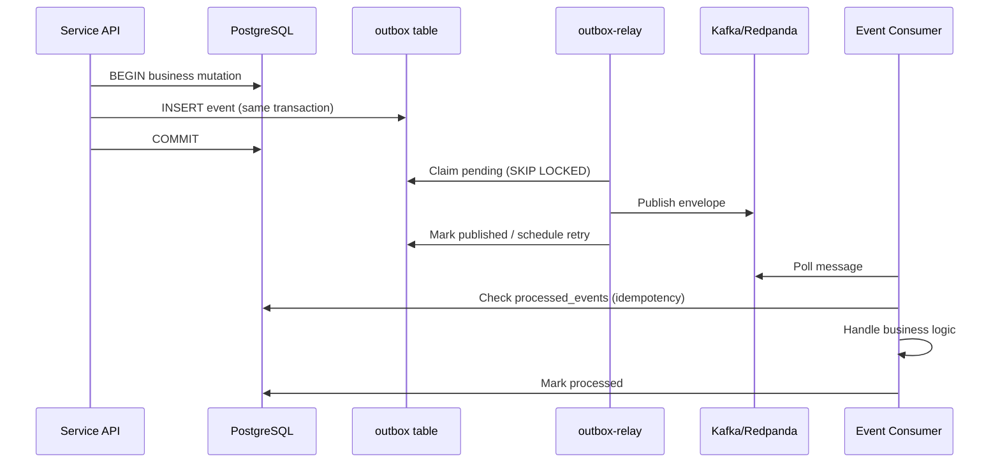

# Event-Driven Architecture

Halcyon uses a transactional outbox with Kafka (Redpanda locally) for reliable domain event delivery.

## Flow

## Delivery Semantics

- **At-least-once** delivery to Kafka and consumers.
- **Not exactly-once** — consumers must be idempotent via `processed_events`.
- Ordering is preserved per partition key within a topic partition.

## Partition Key Strategy

| Priority | Key | Rationale |
|---|---|---|
| 1 | `organization_id` | Tenant-scoped ordering when present |
| 2 | `aggregate_id` | Aggregate ordering fallback |
| 3 | `event_id` | Last resort for system events |

Topics follow domain boundaries: `halcyon.auth`, `halcyon.organizations`, `halcyon.incidents`. Dead-letter topics use `{topic}.dlq`.

## Transactional Outbox

Business state and outbox rows commit atomically. The relay publishes asynchronously. If Kafka is unavailable, business transactions still succeed and events remain in the outbox until relay retry succeeds.

## Retry and DLQ

| Stage | Behavior |
|---|---|
| Outbox relay | Exponential backoff via `next_attempt_at`; max attempts then DLQ |
| Consumer | In-process retry with backoff; poison messages to DLQ |

## Observability

Prometheus metrics include `outbox_events_created_total`, `outbox_events_published_total`, `outbox_pending_events`, `kafka_messages_consumed_total`, and `dead_letter_events_total`. Structured logs use `event_created`, `event_publish_success`, `event_consumed`, and `event_dead_lettered` — never secrets or tokens.

## Correlation

`correlation_id` and `causation_id` propagate from HTTP headers through commands, outbox events, Kafka messages, and consumer logs.

## Related

- [Event-Driven Architecture (detailed)](event-driven-architecture.md)
- [Event Catalog](catalog.md)
- [EVENT_GUIDELINES.md](../../EVENT_GUIDELINES.md)
