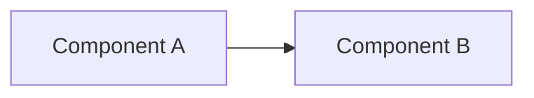

# RFC-NNNN: Title

| Field | Value |
|---|---|
| **Status** | Draft |
| **Author** | @github-username |
| **Created** | YYYY-MM-DD |
| **Updated** | YYYY-MM-DD |
| **Reviewers** | @reviewer1, @reviewer2 |
| **Related ADRs** | ADR-0000 (if any) |
| **Related RFCs** | RFC-0000 (if any) |

---

## Summary

One paragraph: what is being proposed and why it matters.

---

## Motivation

### Problem

What problem does this solve? Who is affected?

### Goals

- Goal 1
- Goal 2

### Non-Goals

- Explicitly out of scope item 1
- Explicitly out of scope item 2

---

## Proposal

Detailed design. Include diagrams where helpful.

### API Changes

If applicable, describe new endpoints or schema changes. Final spec goes in `contracts/`.

### Event Changes

If applicable, describe new events. Final schema goes in `contracts/events/`.

### Data Model

If applicable, describe tables, indices, and migration plan.

---

## Alternatives Considered

| Alternative | Pros | Cons | Why Rejected |
|---|---|---|---|
| Option A | | | |
| Option B | | | |

---

## Impact

### Services Affected

- `services/auth`
- `services/workflow`

### Migration / Rollout

How do we deploy this safely? Feature flags? Phased rollout?

### Observability

What metrics, logs, and alerts are needed?

### Security

Tenant isolation, auth changes, new attack surface.

### Performance

Latency budget impact, scale implications.

---

## Testing Strategy

- Unit tests: ...
- Integration tests: ...
- Load tests: ...
- Manual validation: ...

---

## Open Questions

- [ ] Question 1
- [ ] Question 2

---

## Timeline Estimate

| Phase | Duration |
|---|---|
| Design + RFC review | 1 week |
| Implementation | 2 weeks |
| Testing + rollout | 1 week |

---

## References

- Link to prior art, papers, or competitor implementations
- Link to related issues or discussions
