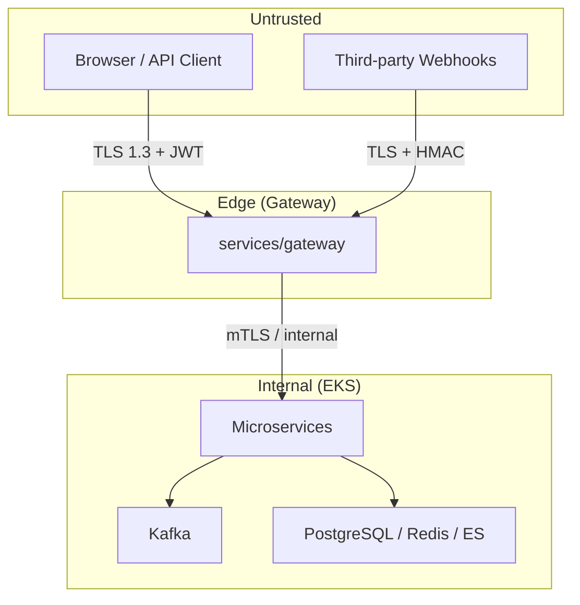

# Halcyon Threat Model

## Why This Document Exists

Halcyon processes authentication credentials, tenant operational data, and AI-generated
intelligence. A documented threat model ensures security requirements are designed in,
not bolted on — and gives auditors and enterprise customers evidence of security rigor.

## Who Reads This

| Audience | Purpose |
|---|---|
| Security reviewers | Evaluate PRs against known threats |
| Service engineers | Understand what to protect |
| Enterprise customers | Security questionnaire responses |
| Incident responders | Know likely attack vectors |

## Standards for Every PR

- Changes to components in the threat model scope require security review.
- New external integrations add rows to the integration threat table.
- Mitigations must not regress — security regressions block merge.
- Update this document when attack surface materially changes.

---

## Scope

### In Scope

| Component | Data Handled |
|---|---|
| `services/auth` | Credentials, JWT, API keys, MFA secrets |
| `services/user` | PII (name, email) |
| `services/organization` | RBAC, membership |
| `services/gateway` | All API traffic |
| `services/ingestion` | Webhooks, third-party payloads |
| `services/workflow` | Incidents, operational data |
| `services/ai` | Prompts, LLM responses, embeddings |
| `services/audit` | Immutable audit trail |
| `apps/web`, `apps/admin` | Browser sessions |
| Kafka, PostgreSQL, Redis, S3, Elasticsearch | All persisted data |

### Out of Scope

- Third-party SaaS security (Datadog, GitHub, PagerDuty) — covered by vendor assessment
- Physical datacenter security — AWS responsibility
- Client device compromise — user responsibility

---

## Assets

| Asset | Classification | Impact if Compromised |
|---|---|---|
| User credentials | Confidential | Account takeover |
| JWT / refresh tokens | Confidential | Session hijacking |
| API keys | Confidential | Programmatic abuse |
| Tenant operational data | Confidential | Business intelligence leak |
| Incident content | Confidential | Operational exposure |
| Audit log | Integrity-critical | Compliance failure, undetected tampering |
| AI prompts and responses | Internal | Prompt injection, data exfiltration |
| Infrastructure credentials | Secret | Full platform compromise |

---

## Trust Boundaries

---

## Threat Actors

| Actor | Capability | Motivation |
|---|---|---|
| External attacker | Network access, credential stuffing | Data theft, disruption |
| Malicious tenant | Valid API access, one org | Cross-tenant data access |
| Compromised integration | Webhook spoofing, poisoned payloads | Data injection, DoS |
| Insider (engineer) | Production access | Data exfiltration (rare) |
| AI adversary | Prompt injection via incident content | Hallucination, data leak |

---

## STRIDE Analysis

### Spoofing

| Threat | Mitigation | Owner |
|---|---|---|
| Webhook spoofing | HMAC signature validation per integration | ingestion |
| JWT forgery | RS256 signing, key rotation | auth |
| Session fixation | Secure cookie flags, rotation on login | auth |

### Tampering

| Threat | Mitigation | Owner |
|---|---|---|
| Audit log modification | Hash-chained entries, append-only | audit |
| Event payload manipulation | Schema validation, signed envelopes | all consumers |
| MITM on API | TLS 1.3 everywhere | gateway, infra |

### Repudiation

| Threat | Mitigation | Owner |
|---|---|---|
| Deny performing action | Immutable audit log with actor attribution | audit |
| API key abuse undetected | Per-key usage logging and alerting | auth |

### Information Disclosure

| Threat | Mitigation | Owner |
|---|---|---|
| Cross-tenant data leak | `org_id` on every query, RLS, integration tests | all services |
| PII in logs/traces | Scrubbing, no PII in metric labels | all services |
| Error stack traces | RFC 7807 errors, no internals in production | all APIs |
| AI training on customer data | Contractual + technical prohibition | ai |
| Prompt injection exfiltration | Input sanitization, output guardrails | ai |

### Denial of Service

| Threat | Mitigation | Owner |
|---|---|---|
| API flooding | Rate limiting at gateway | gateway |
| Webhook flood | Per-org ingestion limits, queue backpressure | ingestion |
| Kafka consumer lag | Autoscaling, DLQ, alerting | all consumers |
| Expensive AI queries | Per-org AI rate limits, cost caps | ai |

### Elevation of Privilege

| Threat | Mitigation | Owner |
|---|---|---|
| RBAC bypass | Service-layer enforcement, not gateway-only | all services |
| API key scope escalation | Scoped permissions, immutable after creation | auth |
| Privilege escalation via bugs | Security review on auth changes | auth, org |

---

## Integration Threats

| Integration | Threat | Mitigation |
|---|---|---|
| GitHub webhooks | Forged deploy events | HMAC-SHA256 signature |
| Datadog webhooks | Alert injection | Shared secret validation |
| PagerDuty webhooks | Incident spoofing | Token + signature |
| LLM providers | Data retention, prompt leak | No PII in prompts; BAA where required |
| OAuth providers | Token interception | PKCE, state parameter |

---

## AI-Specific Threats

| Threat | Description | Mitigation |
|---|---|---|
| Prompt injection | Malicious content in incident drives AI behavior | Input scanning, system prompt isolation |
| Hallucinated evidence | AI cites non-existent events | Citation validation against operational graph |
| Data exfiltration via AI | Crafted prompts leak other tenant data | Strict `org_id` scoping in RAG retrieval |
| Model poisoning | N/A (we use external models) | Vendor assessment |

---

## Security Controls Summary

| Control | Implementation |
|---|---|
| Authentication | JWT + OAuth2 + MFA |
| Authorization | RBAC at service layer |
| Encryption in transit | TLS 1.3 |
| Encryption at rest | AES-256 (RDS, S3) |
| Secrets | AWS Secrets Manager |
| Audit | Hash-chained immutable log |
| Vulnerability scanning | Trivy, Dependabot in CI |
| Rate limiting | Gateway per org/user/key |

---

## Review Schedule

| Activity | Frequency |
|---|---|
| Threat model review | Quarterly |
| Penetration test | Annually (pre-SOC 2) |
| Dependency audit | Continuous (CI) |
| Access review | Quarterly |

---

## Related Documents

- [SECURITY.md](../../SECURITY.md)
- [ARCHITECTURE.md](../../ARCHITECTURE.md)
- [API_GUIDELINES.md](../../API_GUIDELINES.md)
- [EVENT_GUIDELINES.md](../../EVENT_GUIDELINES.md)
